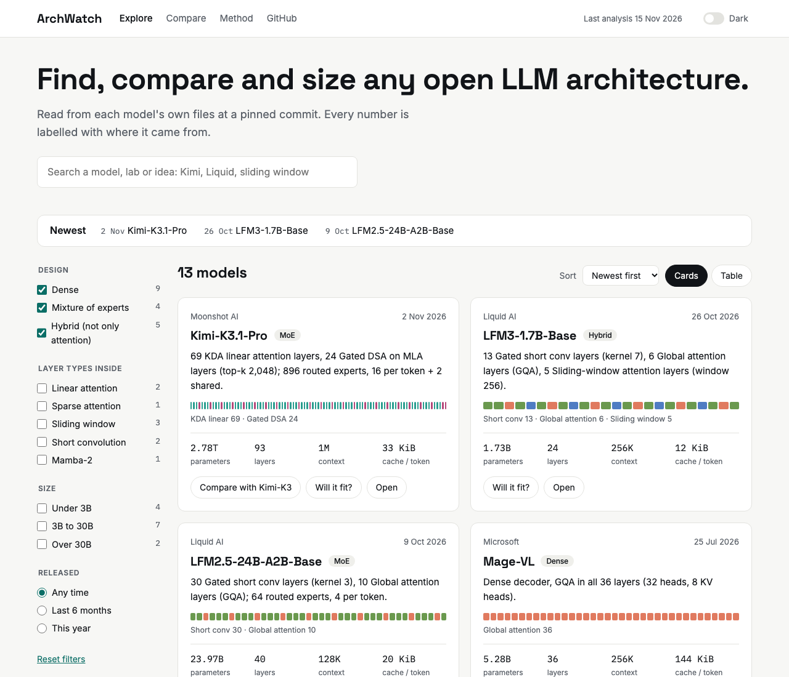

# ArchWatch

**Every new open-weight LLM, explained from its own files.** ArchWatch finds new models on Hugging Face, reads
their config, weight headers, code and model card, checks every number against a second source, and publishes a
page with the architecture, a diagram and where each number came from.

**Live site: [archwatch.vercel.app](https://archwatch.vercel.app)**

[](https://archwatch.vercel.app)

## How it works

```
watcher  ->  read the model's files  ->  verify  ->  diagrams  ->  site
```

1. **Watcher** (`watch.py`, daily GitHub Action, no LLM calls). Checks ten core publishers plus trending and recent
   releases on Hugging Face, pins each candidate to a commit, skips fine-tunes, quantizations and duplicates, and
   picks a predecessor from the same family and size class (total parameters within 2x, both dense or both MoE).
2. **Read the files** (`src/archwatch/`). `config.json` is mapped to a schema; parameter counts come from safetensors
   **headers** fetched with HTTP range requests (no weights are downloaded); modeling code is scanned statically
   (never executed); model-card claims are parsed with their rounding. Remote code is never run.
3. **Verify.** Each fact is compared across every file that states it. Agreeing facts are published; a disagreement
   is held for a person to resolve instead of being guessed. Architectures whose layout or cache rule is not yet
   supported are held as a whole.
4. **Diagrams.** A spec built only from verified fields is drawn by Gemini as SVG, then checked by code (layout,
   text, every number against the spec). Only diagrams that pass every check are shown; otherwise the page uses a
   diagram drawn by code. New diagrams arrive through a reviewed pull request.
5. **Site** (`build_site.py`). A static site built offline from the committed records and deployed on Vercel on every
   merge to `main`: explore and filter, one page per model (layer by layer, diagram, memory planner, facts and
   sources) and side-by-side comparisons with the predecessor.

## How numbers are checked

| Label | Meaning |
|---|---|
| **verified** | Two independent files agree (for example `config.json` and the weight headers). |
| **one source** | Only one file states it; published and labelled as such. |
| **computed** | Derived by ArchWatch's calculator from published facts (cache per token, memory estimates). |
| **differs from card** | Our count follows one fixed rule for every model; the card's own figure is shown next to it. |
| **held for review** | The files disagree, or the architecture is not yet supported; no number is shown. |

Fixed counting rules, the same for every model: total parameters are all stored tensors except multi-token-prediction
modules (reported separately); active parameters per token exclude unselected experts, lookup tables and the input
embedding, and keep the output head. Cache figures are bf16 cache state, not measured runtime memory.

## Free stack and limits

- **Hugging Face Hub** for discovery and files (headers only, never weight payloads).
- **Gemini free tier** for diagrams only. Every call, including experiments, counts against one daily budget set in
  [`config/providers.yaml`](config/providers.yaml) and is logged in [`data/gemini-requests.json`](data/gemini-requests.json).
  Diagram runs are Monday, Wednesday and Friday, at most five models and 15 calls per run.
- **GitHub Actions** for CI, the daily watcher and the diagram queue; **Vercel** for the site.
- No paid API, no database, no server: the repository is the data store.

LLMs never supply architecture facts. They only draw or explain facts that the verifier has already published.

## Run locally

Python 3.12 and [uv](https://docs.astral.sh/uv/):

```bash
uv sync --locked --python 3.12
uv run --frozen pytest -q                 # offline tests
uv run --frozen python build_site.py      # site/ from the committed records, no network
python -m http.server 4173 --directory site
```

Analyse models from their live sources (reads files and weight headers from Hugging Face, no weights):

```bash
uv run --frozen python run.py moonshotai/Kimi-K3.1-Pro:moonshotai/Kimi-K3
uv run --frozen python watch.py --process       # discovery plus bounded processing
```

Gemini diagram generation needs `GEMINI_API_KEY` in a local `.env` (never committed):
`uv run --frozen python tools/diagram_queue.py --plan` shows the next run without making any call.

## What's next

- Drawing and cache rules for the held architectures: compressed and sparse attention with hyper-connections, KV
  shared across layers, chunked attention, block diffusion and recurrent layers.
- Explanations of "what changed" written by Gemini, shown only when every number passes the code checks.
- A held-out, human-reviewed evaluation set for extraction accuracy.
- Plain-language mode, concept pages and an RSS feed of new architectures.
